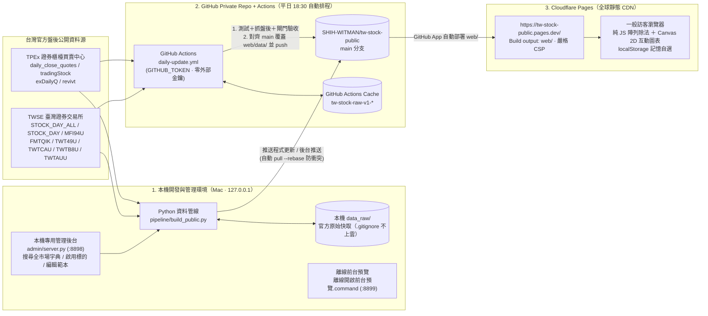

# 台股含息趨勢觀察（公開免費雲端版）系統架構書

- **開發設計者**：witman
- **專案目錄**：`/Users/witman/Projects/tw-stock-public/`（與個人本機帳務系統 `stockV2.1-Flask` 完全隔離）
- **版本階段**：Phase 1 正式上線運作版（5 年歷史、44 檔啟用標的、平日 18:30 全自動更新）
- **線上網址**：`https://tw-stock-public.pages.dev/`
- **GitHub 倉庫**：`SHIH-WITMAN/tw-stock-public`（Private）
- **最後更新日期**：2026-11-28
- **文件定位**：本文件為公開雲端版之**唯一現行系統架構與設計規範（Single Source of Truth）**，整合早期規劃書與跨 AI 審查結論並完整反映實際落地實作。後續任何功能、管線、介面或排程異動，均須同步維護本文件與文末修訂紀錄。
- **相關文件**：
  - [Phase 0 官方來源實測與授權評估報告](Phase0_官方來源實測與授權評估報告.md)
  - [TWSE／TPEx 授權確認信草稿](TWSE_TPEx_授權確認信草稿.md)
  - [GitHub 建倉與試跑步驟教學](GitHub_建倉與試跑步驟教學.md)
  - 歷史規劃參考（已封存，不代表現行規格）：
    - [公開雲端版_規劃書](歷史規劃/公開雲端版_規劃書.md)
    - [公開雲端版_Claude審查意見](歷史規劃/公開雲端版_Claude審查意見.md)
    - [公開雲端版_Codex審查與改善方案](歷史規劃/公開雲端版_Codex審查與改善方案.md)

---

## 一、定位邊界與三方規劃審查定案總覽

### 1-1. 與個人本機版 `stockV2.1-Flask` 的嚴格隔離

| 構面 | 個人本機版 `stockV2.1-Flask` | 公開免費雲端版 `tw-stock-public` |
|---|---|---|
| **核心用途** | 個人／家庭多成員記帳、庫存成本、54C 報稅、FIRE 退休試算 | 公開免費、免註冊之台股／ETF 含息趨勢比較與年度報酬觀測 |
| **資料來源** | FinMind API ＋ 本地 SQLite 雙資料庫 ＋ GAS／LINE | **100% 台灣官方端點（TWSE／TPEx）**，完全不依賴 FinMind |
| **資料庫與個資** | 個人帳務 `stock_data.db`、`market_data.db` | **零後端資料庫、零登入、零個資**；訪客自選僅存瀏覽器 `localStorage` |
| **部署型態** | 本機 Flask 應用（macOS／Windows） | **純靜態網站（Cloudflare Pages）** ＋ GitHub Actions 盤後批次產檔 |

### 1-2. 早期規劃書、Claude 審查與 Codex 審查之最終定案對照

系統重新審視原三份文件後，依「單人好維運、資料零漂移、零雲端外部金鑰、介面精簡直覺」原則定案如下：

| 議題 | 原規劃／審查建議 | 最終實作定案與理由 |
|---|---|---|
| **財務引擎架構** | Claude §3-1 建議 Python 預產 `tri[]`/`pri[]`，瀏覽器僅做除法 | **全面採納**。演算法版本 `tri_ex_close_gross_v1`，趨勢頁與 ETF 年度報酬頁共用同一衍生指數，徹底消除雙引擎漂移。 |
| **資料來源與授權** | Codex §3 指出 FinMind 禁止再散布、SITCA 需授權、官方端點須分級 | **全面採納**。100% 改用 TWSE／TPEx 官方端點；`data_raw/` 不入 Git 也不上雲；前端序列僅發衍生指數 `tri[]`/`pri[]`，僅於 `catalog.json` 附最新單日官方收盤價（對應 `data.gov.tw` 開放資料第 1 級）。 |
| **資料品質閘門** | Claude §3-3 建議以「官方開盤參考價」取代 ±25% 門檻 | **全面採納**。建立 Fail-Closed 官方參考價閘門（涵蓋 `TWT49U`、`TWTCAU`、`TWTB8U`、`TWTAUU`、`exDailyQ`、`revivt`），缺事件即中止版本切換；並補齊颱風順延除息與純有償現金增資除權（`rights_issue`）。 |
| **前端技術棧** | 原規劃 TypeScript＋Vite＋Tailwind＋Plotly | **大幅輕量化改造**。改用純原生 HTML + CSS + ES Modules + Canvas 2D HiDPI 互動圖表（總碼量僅 **~83 KB**、零 `node_modules`、零建置步驟），首屏秒開且免套件維護。 |
| **雲端託管與儲存** | Codex／Claude 建議首版只用 Cloudflare Pages，延後 R2 與 Firestore | **全面採納**。僅使用 Cloudflare Pages 託管 `web/`，免登入、免 R2、免 Firestore、免 Workers。 |
| **自動化排程與憑證** | 討論 Wrangler Token（Cloudflare API Key）vs 內建 `GITHUB_TOKEN` | **採納「替代方案 A（零外部金鑰）」**。GitHub Actions 平日 18:30 僅用當次自動銷毀之 `GITHUB_TOKEN` 推 `web/data/` 回 `main`，搭配 `actions/cache` 保存雲端 `data_raw/`，由既有 Cloudflare Pages GitHub App 自動觸發上線。 |
| **匯出 PNG／圖卡標題／匯出匯入組合** | 原規劃包含 PNG 圖卡匯出、自訂標題與 JSON 組合匯出／匯入 | **依使用者實測回饋移除**，保持前台介面聚焦於快速選股與趨勢比較；保留「複製最新分享連結」與「複製固定快照連結」。 |
| **跨類別與大盤比較口徑** | Claude §2-4 原建議海外與債券 ETF 不與台股大盤比 | **依使用者「統一機會成本基準」需求調整定案**。含息趨勢頁所有快速組合統一預設納入 `TAIEX`；ETF 年度報酬頁全類別統一計算完整年度勝大盤次數，並以中性備註提醒匯率與資產波動差異。 |
| **較晚上市標的處理** | 曾實測模式 A（嚴格同起點）與模式 B（上市日 0% 接續） | **定案僅保留模式 A（公平同起點）**，避免不同起跑點誤導報酬高低；搭配「單選晚掛牌自動對齊上市日」與「混選老新股時於圖表正上方跳醒目一鍵切共同起點橫幅」。 |
| **Phase 1.5 / 2 功能** | 單筆／定期定額回測頁、SITCA 月報規模／受益人 | **回測比較頁已於 2026-11-28 提前落地至 Phase 1**（採除息日收盤口徑、直接由現有 `tri[]`/`pri[]` 精算、固定每月 5/15/25 日或單筆投入、不含不可買賣之 `TAIEX`、附精簡 4 格重點明細與嚴謹 XIRR）；SITCA 月報規模／受益人續留後續階段。 |

---

## 二、系統整體架構與目錄地圖

### 2-1. 三層分離架構圖



### 2-2. 專案目錄與關鍵檔案地圖

```text
/Users/witman/Projects/tw-stock-public/
├── AGENTS.md                         # 本專案開發接續指引（強制同步更新本架構書）
├── README.md                         # 專案簡介與快速指令
├── requirements.txt                  # Python 唯一外部依賴：requests==2.32.3
├── .gitignore                        # 明確排除 data_raw/、__pycache__、.DS_Store
├── .github/
│   └── workflows/
│       └── daily-update.yml          # 平日 18:30 全自動更新與手動 Run workflow 排程
├── config/
│   ├── universe.json                 # 候選標的池（目前 45 檔、44 檔啟用）與 6 組快速組合
│   └── manual_overrides.json         # 重大公司事件人工覆核覆寫表
├── pipeline/
│   ├── sources.py                    # TWSE／TPEx 官方抓取層、雙軌增量快取與防鎖節流
│   ├── engine.py                     # 核心財務運算引擎（tri/pri、閘門、滾動與曆年報酬）
│   └── build_public.py               # 批次建置入口、共同收盤日對齊與版本化 JSON 輸出
├── web/                              # 【唯一部署至 Cloudflare Pages 之目錄】
│   ├── _headers                      # Cloudflare 安全標頭（嚴格 CSP）與快取規則
│   ├── index.html                    # 主頁面骨架（含息趨勢 / ETF 年度報酬 / 資料狀態）
│   ├── styles.css                    # 1480px 寬版面、深淺主題與黃金基準線樣式
│   ├── js/
│   │   ├── model.js                  # 純前端數學模型（除法報酬、停牌/晚上市處理、URL 編解碼）
│   │   ├── backtest.js               # 純前端回測引擎與 XIRR 求解器（單筆 / 每月 5,15,25 定期定額）
│   │   ├── chart.js                  # Canvas 2D HiDPI 走勢圖、右側標籤避碰與十字準線
│   │   └── app.js                    # 主 UI 控制器（零 innerHTML、CSSOM 樣式套用）
│   └── data/
│       ├── latest.json               # 原子切換指標（短快取 5 分鐘）
│       └── v/<YYYYMMDD-HHMMSS>/      # 版本化不可變快照（長快取 1 年 immutable）
│           ├── manifest.json         # 版本資訊、資料日、演算法版本、來源顯名與警示
│           ├── calendar.json         # 官方共用交易日曆
│           ├── catalog.json          # 全標的目錄、TAIEX 基準列、最新單日收盤價、年度報酬與範本
│           └── series/<TICKER>.json  # 單檔衍生指數陣列（僅含 tri[]/pri[]，不含歷史原價）
├── admin/                            # 【僅本機 127.0.0.1 使用，不部署至 Cloudflare】
│   ├── server.py                     # 本機管理後台 HTTP API（埠 8898）
│   └── index.html                    # 本機後台管理介面（搜尋全市場字典、啟用、抓檔、推送）
├── tests/
│   ├── test_engine.py                # Python 引擎單元測試（8 項）
│   ├── model.test.mjs                # 前端純模型 Node 單元測試（8 項）
│   └── browser_smoke.cjs             # 瀏覽器端整合冒煙測試
├── doc/
│   ├── 雲端版系統架構書.md             # 【本文件】現行完整系統架構與維護依據
│   ├── Phase0_官方來源實測與授權評估報告.md
│   ├── TWSE_TPEx_授權確認信草稿.md
│   ├── GitHub_建倉與試跑步驟教學.md
│   └── 歷史規劃/                      # 早期三份規劃與交叉審查封存文件
├── data_raw/                         # 【本機／雲端快取限定，永不進 Git】TWSE/TPEx 原始 JSON 快取
├── 開啟後台管理.command                # macOS 雙擊啟動本機後台（127.0.0.1:8898）
├── 離線開啟前台預覽.command            # macOS 雙擊離線預覽本機前台（127.0.0.1:8899）
├── 更新每日資料並推送.command          # macOS 本機測試、抓近 5 年官方資料並推送
└── 推送程式更新.command                # macOS 本機跑測試、自動 pull --rebase 並推送程式碼
```

---

## 三、官方資料來源、增量快取與品質閘門

### 3-1. 官方資料端點清單（完全無 FinMind 依賴）

| 資料用途 | 市場 | 官方端點 | 更新與快取策略 |
|---|---|---|---|
| 全市場最新單日收盤＋字典 | 上市 TWSE | `openapi.twse.com.tw/v1/exchangeReport/STOCK_DAY_ALL` | 每次建置即時抓取（1 次請求），供增量補丁與後台搜尋字典 |
| 全市場最新單日收盤＋字典 | 上櫃 TPEx | `tpex.org.tw/openapi/v1/tpex_mainboard_daily_close_quotes` | 每次建置即時抓取（1 次請求），供增量補丁與後台搜尋字典 |
| 單檔月歷史收盤 | 上市 TWSE | `twse.com.tw/rwd/zh/afterTrading/STOCK_DAY` | 歷史月永久快取；當月僅於快取與 OpenAPI 皆落後大盤日才重抓 |
| 單檔月歷史收盤 | 上櫃 TPEx | `tpex.org.tw/www/zh-tw/afterTrading/tradingStock` | 同上（涵蓋上櫃美債／投等債 ETF） |
| 加權報酬指數（含息大盤） | 大盤 TWSE | `twse.com.tw/rwd/zh/TAIEX/MFI94U` | 歷史月永久快取，當月刷新；作為 `TAIEX` 含息基準 |
| 加權股價指數（價差大盤） | 大盤 TWSE | `twse.com.tw/rwd/zh/afterTrading/FMTQIK` | 歷史月永久快取，當月刷新；作為 `TAIEX` 純價差基準與指數點位 |
| 除權息計算結果與明細 | 上市 TWSE | `twse.com.tw/rwd/zh/exRight/TWT49U` ＋ `TWT49UDetail` | 按年度快取（今年刷新）；含現金股利、無償配股與有償現金增資 |
| 除權息計算結果 | 上櫃 TPEx | `tpex.org.tw/www/zh-tw/bulletin/exDailyQ` | 按年度快取（今年刷新） |
| ETF 分割／反分割參考價 | 上市 ETF | `twse.com.tw/rwd/zh/split/TWTCAU` | 按年度快取（如 `0050` 2025/06/18 1拆4、`0052` 2025/11/26 1拆7） |
| 個股變更面額（分割） | 上市個股 | `twse.com.tw/rwd/zh/change/TWTB8U` | 按年度快取（如 `2327` 2025/08/25 1拆4） |
| 減資恢復買賣參考價 | 上市／上櫃 | TWSE `TWTAUU` ／ TPEx `revivt` | 按年度快取（如 `2603` 2022/09/19 現金減資 60%）；含彌補虧損與退還股款 |

### 3-2. 雙軌智慧抓取、防鎖節流與日期對齊防呆

1. **節流保護（[pipeline/sources.py](file:///Users/witman/Projects/tw-stock-public/pipeline/sources.py)）**：
   - 預設單次請求間隔 `delay=0.8s`，每累積 **25 次網路請求自動暫停 6 秒**，失敗採指數退避重試（`10s × attempt`，最多 4 次）。
   - 歷史月份採**由最新往最舊反向抓取**，若非當月連續 2 個月無交易資料即判定早於上市日（pre-IPO）提前中止，大幅節省新掛牌 ETF（如 `00935`、`00940`）回填請求數。
2. **快速增量檢查與 `expected_end` 護欄**：
   - 僅當「本機當月快取已達 `taiex_as_of`」或「OpenAPI 全市場快照日期 $\ge$ `taiex_as_of` 且距快取最新日 $\le 4$ 天」時才跳過逐檔當月刷新。
   - 避免大盤指數比 OpenAPI 個股快照提早換日時誤跳個股更新。
3. **發布前共同收盤日對齊（[pipeline/build_public.py](file:///Users/witman/Projects/tw-stock-public/pipeline/build_public.py)）**：
   - 抓完所有啟用標的後，計算「大盤與至少 50% 以上啟用標的皆有收盤價的最新交易日」作為最終 `as_of`。若盤後初期僅大盤已公布而多數個股尚未公告，系統自動將本次發布對齊至前一個完整收盤日，絕不發布半套資料。

### 3-3. 官方參考價發布閘門（Fail-Closed Gate）

[pipeline/engine.py](file:///Users/witman/Projects/tw-stock-public/pipeline/engine.py) 在建置每檔衍生指數時執行嚴格把關：
- **確定性事件比對**：凡官方參考價表（`TWT49U`、`TWTCAU`、`TWTB8U`、`TWTAUU`、`exDailyQ`、`revivt`）任一日出現 `|after - before| / before > 0.1%`，而該日事件表無對應紀錄，即觸發 `gate_errors`，**直接中止整個版本建置且不切換 `latest.json`**。
- **特殊事件實戰規則**：
  - **全市場休市順延除息／減資**（實例：`2891 中信金` 2026-07-10 颱風休市順延至 2026-07-13）：若事件日不在官方交易日曆且距次一交易日 $\le 7$ 天，自動沿用次一交易日收盤價再投入，不誤設斷點。
  - **有償現金增資除權**（實例：`2882 國泰金` 2022-12-05、`2884 玉山金` 2023-04-07、`2881 富邦金` 2021-09-06）：解析 `TWT49UDetail` 第 6 欄有償增資股數，在扣除現金股利與無償配股後計算殘餘除權因子 `rights_issue`，維持 `tri[]` 與 `pri[]` 價格連續性且不誤計入配息次數（`div_count`）。
  - **無法解析之合併增減資**：標記為 `capital_reduction_unsupported` 並寫入 `breaks[]` 斷點，不偽造跨段報酬。
- **輔助漲跌幅警示**：具國內 ±10% 漲跌幅限制之標的，於無事件日單日調整後變動超過 11.5% 會寫入 `manifest.warnings` 供人工複查；國外成分股 ETF 與債券 ETF 因無漲跌幅限制（`has_price_limit: false`）不誤報。

---

## 四、核心財務計算口徑與前端邊界處理

### 4-1. 單一計算真理（`tri_ex_close_gross_v1`）

- Python 端對齊官方交易日曆，以每檔最早有效交易日為基期 100.0，逐日計算：
  - **單日多事件執行順序**：① `split` / `capital_reduction`（含現金減資退還股款以復牌收盤再投入） → ② `cash`（以當下股數計算現金股利） → ③ `stock` / `rights_issue`（無償配股與增資除權倍率） → ④ 除息日收盤再投入（僅 `tri_shares += cash / close`，`pri_shares` 不再投入現金股利）。
  - **任一子區間報酬**：前端僅對預產陣列做精確除法：
    $$R(s, t) = \left(\frac{\text{TRI}(t)}{\text{TRI}(s)} - 1\right) \times 100\%$$
  - 含息趨勢、ETF 滾動報酬（YTD / 1Y / 3Y）與 ETF 曆年度報酬 100% 共用同一 `tri[]` 陣列。

### 4-2. 前端時間軸與缺漏邊界規則（[web/js/model.js](file:///Users/witman/Projects/tw-stock-public/web/js/model.js)）

| 情境 | 處理規則 | 使用者視覺提示 |
|---|---|---|
| **起算日休市** | 向前找 14 個日曆天內最近交易日；若無則向後取首個交易日 | 標題列明示實際起訖交易日與交易日數 |
| **區間中段短期停牌** | 連續缺漏 $\le 20$ 交易日且非長期停牌（缺漏 $\le 10$ 日或占比 $\le 10\%$），停牌日記 `null` 不填假價並銜接復牌日 | 圖表下方提示停牌標的與日數；滑鼠懸停顯示「停牌」 |
| **起算日逢中段停牌**<br>（如 `0052` 分割停牌） | 區分「已上市短暫停牌」與「尚未掛牌」：起算日前 14 個日曆天內若有有效收盤價，自動沿用停牌前最後收盤作為基準（起點錨定 `0%`），不踢除標的 | 卡片顯示 `沿用 YYYY-MM-DD 停牌前基準`；圖表上方顯示藍色提示條 |
| **結束日短暫停牌／延遲** | 若任一已選標的於結束日缺收盤但在前 7 個日曆天內有收盤，自動將全部標的統一對齊至共同收盤日 | 圖表上方顯示藍色提示條明示共同收盤日 |
| **只選晚上市標的＋大盤**<br>（如只選 `00940`＋大盤） | 若所選非大盤標的皆晚於起算日掛牌（原區間將只剩大盤孤線），自動將起算日對齊至已選標的之共同上市日進行公平比較 | 圖表正上方顯示藍色提示條 ＋ `[切回原起算日]` 按鈕 |
| **混選老股＋晚上市新股** | **嚴格維持模式 A（公平同起點）**：老股與大盤照畫完整區間，晚上市標的列為未列入而不混入不同起跑線 | 圖表正上方顯示醒目琥珀色橫幅 ＋ **`[一鍵改從共同起點 YYYY-MM-DD 重比]`** 主按鈕 |
| **區間含資料斷點或長期停牌** | 排除於該次比較，不產生誤導曲線 | 明列於圖表下方「未列入圖表」與原因說明 |

### 4-3. ETF 年度報酬與排名口徑

- **統一基準**：全類別（台股股票型、國外成分股、債券型）統一對照 **`TAIEX 加權報酬指數（台股大盤）`** 計算完整年度勝大盤次數（不含今年 YTD，缺完整年顯示 `—` 不算輸）。
- **大盤參與排名與黃金分界線**：
  - 預設排序為 **`近 1 年含息降冪`**（另支援「今年以來降冪」「勝大盤次數降冪」「代號升冪」）。
  - 選擇「近 1 年」或「今年以來」排序時，`TAIEX` 直接依其報酬率排進對應位置，並以**琥珀金底色＋加粗金框＋`基準` 徽章**呈現為顯眼分界線；基準線上方最後一列的排名即為勝過大盤的 ETF 檔數。
- **最新單日收盤價**：表格顯示 **`收盤 (MM/DD)`** 欄位（日期隨收盤基準日自動連動；大盤列顯示加權股價指數點位），明確區隔盤後收盤與盤中即時價。

### 4-4. 多標的回測比較口徑（[web/js/backtest.js](file:///Users/witman/Projects/tw-stock-public/web/js/backtest.js)）

- **全站統一除息日收盤口徑（+0 天）**：直接由現有 `tri[]` 與 `pri[]` 反推除息日現金殖利率 $y_t = \frac{\text{TRI}(t)/\text{TRI}(t-1)}{\text{PRI}(t)/\text{PRI}(t-1)} - 1$，零新增官方 API 請求、零對外發布歷史原始股價，且單筆含息回測總報酬率與「含息趨勢」100% 吻合。
- **策略與扣款簡化**：前台僅切換 **`每月固定三次（5、15、25 日）`**（遇休市順延至 14 天內次一交易日，不開放前台修改日期）或 **`單筆投入`**；支援 **`股息再投入（除息日收盤）`** 與 **`股息領現金`**；嚴格遵守 `buy_date < ex_date`（除息日當天買進不領當次配息）。
- **僅比真實可買賣標的**：大盤指數（`TAIEX`）不可直接下單買賣，故不列入回測比較表（想對照大盤定期定額可直接選 `0050`／`006208`）。
- **同期間分列與嚴謹年化**：同期間標的於主表依總報酬率／期末總值／年化／配息排序，較晚上市標的獨立列於下方「不同期間參考」並附一鍵同期間重比鈕；年化報酬採單筆 CAGR ／ 定額多區間網格二分法 XIRR（殘差與多根檢核，持有未滿 1 年或無唯一解顯示 `—`）。
- **精簡重點展開明細**：不塞百筆逐次流水帳，點「展開 ▾」呈現 4 格摘要（扣款次數與持有年數、價差 vs 配息損益拆解、期間最大回撤抗跌度、除息次數與年化口徑）＋ 年度配息小計。

---

## 五、前台介面設計與資安架構（`web/`）

### 5-1. 版面與互動特色

- **整體寬度與主題**：桌機主寬度 `1480px`（讓 ETF 年度報酬頁從 `排名` 到 `2021 年` 共 14 欄免拉水平捲軸完整呈現）；提供淺色／深色雙主題一鍵切換與不撞色 9 色盤。
- **頂部狀態與署名**：顯示 **`收盤基準：YYYY-MM-DD（盤後）`**（明天早盤未收盤前維持前一日收盤基準）與 **`開發設計者：witman`** 徽章（頁尾同步署名）。
- **含息趨勢選股區（整合方案 1）**：
  - 標題列右側內建 **`⚡ 快速組合 ▾`** 精簡下拉選單（6 組預設組合皆統一勾選 `include_market: true`）與 **`▲ 收合 / ▼ 展開`** 切換鈕。
  - **單行精簡已選膠囊列**：只顯示代號膠囊（`TAIEX 大盤 ✕`、`0050 ✕`…，懸停顯示中文全名），右側同列併排 `加入大盤` 勾選與 `清除` 按鈕。
  - **唯一主選股區**：常駐分類頁籤（台股股票型 ETF / 國外成分股 ETF / 債券型 ETF / 台股權值股 / 全部）＋ 即時模糊搜尋下拉 ＋ 固定最大高度（約 3 列、框內滾動）的卡片格狀，讓走勢圖穩居第一屏。
- **圖表與分享**：
  - 單次上限 9 檔（含大盤）；上方摘要卡片基準固定置左，點選卡片可複選聚焦並自動縮放 Y 軸。
  - 提供「複製最新分享連結」與「複製固定快照連結（帶 `ver=` 鎖定版本）」。

### 5-2. 資安與快取策略（[web/_headers](file:///Users/witman/Projects/tw-stock-public/web/_headers)）

1. **零 `innerHTML` 與嚴格 CSP**：
   - 全站 JS 嚴格使用 `document.createElement` ＋ `textContent` 建構節點，防範上游資料或 URL 參數注入 XSS。
   - `web/_headers` 強制套用 `Content-Security-Policy: default-src 'self'; script-src 'self'; style-src 'self'; img-src 'self' data: blob:; connect-src 'self'; object-src 'none'; frame-ancestors 'none'; base-uri 'self'; form-action 'self'`。
   - [web/js/app.js](file:///Users/witman/Projects/tw-stock-public/web/js/app.js) 之 `el()` 透過瀏覽器 **CSSOM（`node.style.setProperty`）** 套用動態卡片顏色，不使用 `setAttribute('style', ...)`，在不放寬 `style-src 'self'` 的前提下確保 Cloudflare 線上版與本機預覽視覺完全一致。
2. **輸入白名單**：分享連結參數於 [web/js/model.js](file:///Users/witman/Projects/tw-stock-public/web/js/model.js) 驗證代號正則 `/^[A-Z0-9]{4,10}$/`、日期格式、上限筆數與版本號格式 `/^[0-9]{8}-[0-9]{6}$/`。
3. **分層快取**：`/data/latest.json` 設 `max-age=300`（5 分鐘內反映新版）；`/data/v/*` 設 `max-age=31536000, immutable`（版本不可變長期快取）。

---

## 六、本機管理後台、維運腳本與全自動排程

### 6-1. 本機專用管理後台（`admin/`）

- 透過 [開啟後台管理.command](file:///Users/witman/Projects/tw-stock-public/%E9%96%8B%E5%95%9F%E5%BE%8C%E5%8F%B0%E7%AE%A1%E7%90%86.command) 啟動 [admin/server.py](file:///Users/witman/Projects/tw-stock-public/admin/server.py)，嚴格綁定 **`127.0.0.1:8898`** 且位於 `web/` 之外，外網與 Cloudflare 訪客完全無法存取。
- 主要功能：
  1. 同步並模糊搜尋 **15,000+ 檔 TWSE／TPEx 官方全市場代號字典**，一鍵加入候選池（自動依名稱分類）或手動新增。
  2. 單鍵切換標的「已啟用（前台顯示）／未啟用（隱藏）」、調整分類、刪除標的、維護快速組合。
  3. 選擇歷史抓取年數（`近 3 年` / `近 5 年`），背景執行測試與建置並於頁面即時輪詢日誌（重新整理頁面自動接回執行中日誌）。
  4. 提供 `/preview/` 本機前台預覽與一鍵推送至 GitHub（內建自動 `git pull --rebase --autostash -X theirs origin main` 防衝突）。

### 6-2. macOS 快捷批次檔一覽

| 檔案 | 功能與適用時機 |
|---|---|
| [開啟後台管理.command](file:///Users/witman/Projects/tw-stock-public/%E9%96%8B%E5%95%9F%E5%BE%8C%E5%8F%B0%E7%AE%A1%E7%90%86.command) | 啟動本機後台（`127.0.0.1:8898`），用於新增／管理標的、編輯組合與檢視預覽 |
| [離線開啟前台預覽.command](file:///Users/witman/Projects/tw-stock-public/%E9%9B%A2%E7%B7%9A%E9%96%8B%E5%95%9F%E5%89%8D%E5%8F%B0%E9%A0%90%E8%A6%BD.command) | 啟動輕量靜態伺服器（`127.0.0.1:8899`），完全離線檢視本機 `web/` 前台（無需網路） |
| [更新每日資料並推送.command](file:///Users/witman/Projects/tw-stock-public/%E6%9B%B4%E6%96%B0%E6%AF%8F%E6%97%A5%E8%B3%87%E6%96%99%E4%B8%A6%E6%8E%A8%E9%80%81.command) | 本機跑測試 → 抓近 5 年官方資料 → 自動對齊遠端並推送 `web/data/` 上線（約 10 秒） |
| [推送程式更新.command](file:///Users/witman/Projects/tw-stock-public/%E6%8E%A8%E9%80%81%E7%A8%8B%E5%BC%8F%E6%9B%B4%E6%96%B0.command) | 本機跑測試 → 自動 `pull --rebase` → 提交並推送程式碼／設定變更至 GitHub |

### 6-3. GitHub Actions 平日 18:30 全自動更新（[daily-update.yml](file:///Users/witman/Projects/tw-stock-public/.github/workflows/daily-update.yml)）

- **觸發條件**：
  - 定時排程：`cron: '30 10 * * 1-5'`（週一～週五 18:30 台北時間），預設跑 `--years 5`。
  - 手動觸發：`workflow_dispatch`（於 GitHub → `Actions` → `Daily Derived-Index Update (Phase 1)` → 右上角 `Run workflow`；可選 `years: 5 / 3` 與 `mode: live / synthetic`）。
- **零外部金鑰設計（替代方案 A）**：
  - 不需建立或存放任何 Cloudflare API Token；僅賦予當次執行的臨時 `GITHUB_TOKEN` 最小權限 `permissions: contents: write`。
  - 推回 `main` 後由 Cloudflare Pages 既有的 GitHub App 自動觸發靜態部署（已於 2026-11-28 實測驗證成功上線 `2026-11-27` 資料）。
- **雲端斷點續傳快取**：
  - 使用 `actions/cache/restore@v4` ＋ `actions/cache/save@v4 (if: always())` 維護雲端 `data_raw/`，快取命中後每日增量執行僅約 20～30 秒（與本機 `data_raw/` 獨立互不干擾）。
- **防衝突與假日防呆**：
  - 產完 `web/data/` 後先暫存至 `/tmp/new_web_data`，切回並對齊最新 `origin/main`，若為定時排程且 `NEW_DATE == CUR_ORIGIN_DATE`（例如國定假日休市）則略過提交；否則覆蓋 `web/data/` 並推送，徹底杜絕 `rename/rename` 衝突。
  - 設定 `concurrency` 群組避免重疊執行；手動測試請優先使用 `Run workflow`（不建議對舊紀錄按 `Re-run all jobs`）。

---

## 七、自動化測試與變更維護規範

### 7-1. 測試套件與驗證指令

每次程式碼修改或推送前，均須通過以下自動化測試：

```bash
cd /Users/witman/Projects/tw-stock-public

# 1. Python 財務引擎與閘門單元測試（8 項）
python3 -B -m unittest discover -s tests -v

# 2. 前端純模型單元測試（8 項）與語法檢查
node --test tests/model.test.mjs
node --check web/js/app.js && node --check web/js/model.js && node --check web/js/chart.js

# 3. 本機批次檔語法檢查
zsh -n "推送程式更新.command" "更新每日資料並推送.command" "離線開啟前台預覽.command" "開啟後台管理.command"
```

- **Python 測試涵蓋（[tests/test_engine.py](file:///Users/witman/Projects/tw-stock-public/tests/test_engine.py)）**：分割與配息子區間除法不變性、現金減資與彌補虧損減資連續性、未明減資 fail-closed 斷點、官方參考價閘門攔截漏事件、TPEx 減資 HTML 解析、颱風休市順延除息日、純有償現金增資除權（`rights_issue`）、曆年度報酬基準比較。
- **JS 模型測試涵蓋（[tests/model.test.mjs](file:///Users/witman/Projects/tw-stock-public/tests/model.test.mjs)）**：TRI 除法與停牌／晚掛牌處理、卡片排序與比較基準置左、雙負報酬少跌／多跌標示、點選聚焦自動帶基準與全選清除、分享 URL 白名單與長度限制、起算日逢中段停牌沿用停牌前基準（`0052` 場景）、結束日 7 天內共同收盤對齊、單選晚上市自動對齊上市日。

### 7-2. 後續維護約定

- 本專案根目錄已建立 [AGENTS.md](file:///Users/witman/Projects/tw-stock-public/AGENTS.md)，明訂未來任何 AI 或人工維護修改本專案時，必須：
  1. 嚴守與 `stockV2.1-Flask` 之專案隔離（不混寫個人資料庫）；
  2. 遵守零 `innerHTML`、嚴格 CSP（CSSOM 樣式）與 `data_raw/` 不入 Git 規範；
  3. **同步更新本文件（`doc/雲端版系統架構書.md`）與文末修訂紀錄**。

---

## 八、後續擴充觀察清單（Phase 1.5 / Phase 2）

1. **正式對外公開前合規確認**：寄出 [TWSE_TPEx_授權確認信草稿.md](TWSE_TPEx_授權確認信草稿.md) 留存官方回覆；若日後要轉 Public Repo，將 `daily-update.yml` 內第三方 Action（`checkout`、`setup-python`、`setup-node`、`cache`）鎖定為完整 40 碼 commit SHA。
2. **Phase 1.5（視需求）**：單筆／定期定額 ETF 回測頁（因上市／上櫃 ETF 已於 Phase 0 實測取得 100% 官方配息發放日；個股發放日無免爬 MOPS 來源，首波限 ETF）、SITCA 月報規模／受益人（須取得書面同意）。
3. **擴容觸發條件**：若未來收錄標的或保留版本數成長至接近 Cloudflare Pages 20,000 檔上限的一半，再評估將 `web/data/v/*` 遷移至 Cloudflare R2。

---

## 九、文件修訂紀錄（Changelog）

| 日期 | 摘要 |
|---|---|
| **2026-11-28 (v1.3)** | **回測比較改為獨立選股並解除 8 檔上限**：與「含息趨勢」選股分離（首次進入自動帶入趨勢頁標的並獨立記憶於 `localStorage`），支援全選 44 檔多標的同表排名，新增「+ 全選本分類」與「同步趨勢頁標的」快捷按鈕。 |
| **2026-11-28 (v1.2)** | **修正 `TWT49UDetail` 配股欄位誤加員工紅利轉增資 Bug（`2884 玉山金` 異常）**：[pipeline/sources.py](file:///Users/witman/Projects/tw-stock-public/pipeline/sources.py) 改為僅讀取第 4 欄「A. 每千股無償配股」，排除第 5 欄「B. 員工紅利轉增資總股數」；並將「回測比較」選股區改為預設展開。 |
| **2026-11-28 (v1.1)** | **新增第 3 分頁「多標的回測比較」**：實作純前端 [web/js/backtest.js](file:///Users/witman/Projects/tw-stock-public/web/js/backtest.js) 與 [tests/backtest.test.mjs](file:///Users/witman/Projects/tw-stock-public/tests/backtest.test.mjs)，採除息日收盤（+0）與全站共用 `tri[]`/`pri[]` 精算、固定每月 5/15/25 扣款 vs 單筆投入、股息再投入／領現、僅列可買賣標的（不含 TAIEX）、同期間／不同期間分表、精簡 4 格重點明細（含最大回撤與年度配息小計）與嚴謹 XIRR 求解器。 |
| **2026-11-28** | **初版建立並整合封存舊文件**：整合原規劃書、Claude／Codex 審查意見並完整記錄 Phase 1 現行實作（44 檔 5 年官方資料、有償增資與颱風順延除息修復、整合方案 1 版面、模式 A 公平同起點、ETF 年度報酬釘選／排入 TAIEX 黃金分界線與最新單日收盤價、嚴格 CSP CSSOM 相容修正、開發者署名、本機後台與離線預覽工具、GitHub Actions 替代方案 A 平日 18:30 全自動排程）。將三份舊規劃／審查文件移至 `doc/歷史規劃/` 封存。 |
